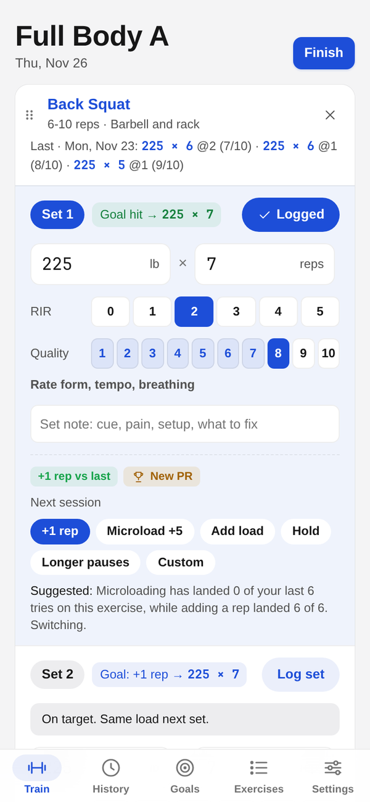
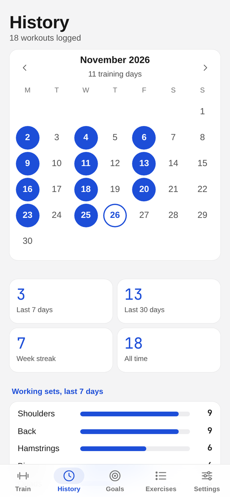
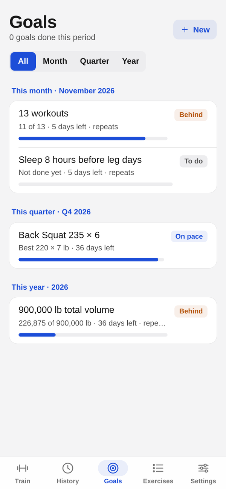
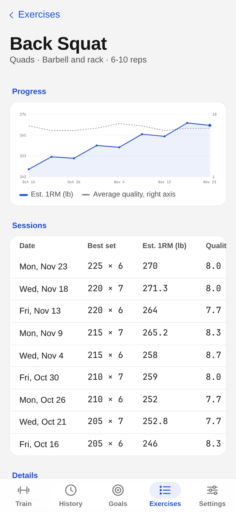
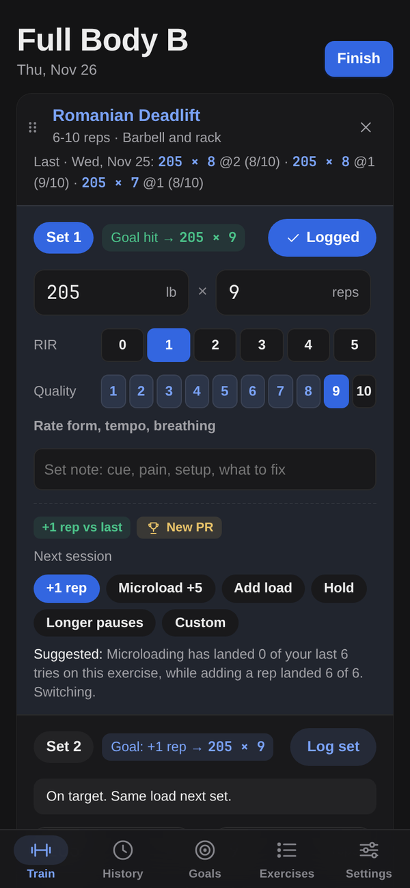
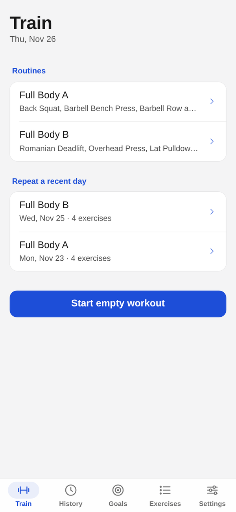
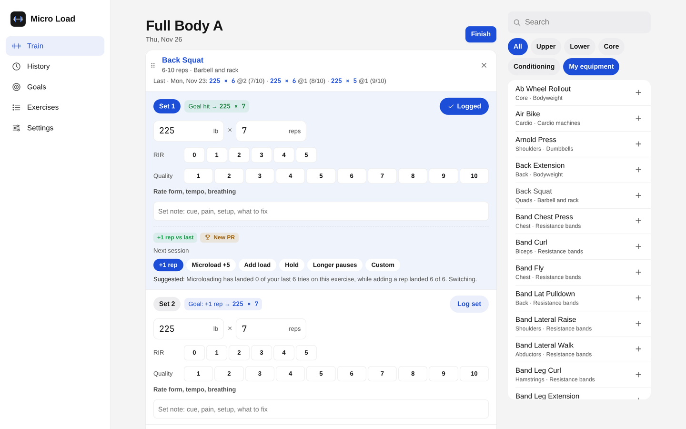

# Micro Load

A self-hosted workout logbook built around one habit: log every set against what you did last time, rate how well you did it, and pick one small step forward for next session.

Micro Load runs as a single small container or as plain static files. It installs to your phone's home screen, works offline at the gym, and keeps your data on your own device or server.

> Micro Load is a logbook, not medical advice. Read the [disclaimer](DISCLAIMER.md) before you use it.

## Contents

- [Use it on your phone](#use-it-on-your-phone)
- [Features](#features)
- [Screenshots](#screenshots)
- [Quick start](#quick-start)
- [Configuration](#configuration)
- [Hosting options](#hosting-options)
- [Data and backups](#data-and-backups)
- [Security](#security)
- [How progression works](#how-progression-works)
- [Development](#development)
- [Project structure](#project-structure)
- [Acknowledgements](#acknowledgements)
- [Disclaimer](#disclaimer)
- [License](#license)

## Use it on your phone

No app store and no account. Micro Load runs in your phone's web browser and installs to your home screen like any other app.

### 1. Open the link

Open **<https://sechrisity.github.io/micro-load/>** on your phone. That is the whole app. Someone may also have given you a link to their own copy. There is no app store version.

### 2. Add it to your home screen

| iPhone (Safari) | Android (Chrome) |
|---|---|
| Open the link in **Safari** | Open the link in **Chrome** |
| Tap the **Share** button (square with an arrow) | Tap the **three dots** menu |
| Tap **Add to Home Screen**, then **Add** | Tap **Install app** or **Add to Home screen** |
| Open Micro Load from the new icon | Open Micro Load from the new icon |

Opening it from the icon gives you the full-screen app. It keeps working at the gym with no signal.

### 3. First time

1. Read the disclaimer and tick both boxes.
2. Answer the short survey: experience, goals, where you train, equipment and a health check. It takes about two minutes.
3. Pick a starter routine on the Train tab and log your first set.

### Keep your data safe

- Unless you were told it syncs to a server, your log lives **only on that phone**, inside the browser.
- Deleting the app, clearing Safari or Chrome data, or switching phones deletes it.
- Every few weeks go to **Settings > Your data > Export backup** and save the file somewhere safe, like your notes, email or cloud storage.
- On a new phone, **Settings > Your data > Import backup** brings everything back.

### Good to know

- **Rest timer sound:** iPhones cannot vibrate from a web app, so the timer plays a short sound instead. It follows the ring and silent switch.
- **Updates** arrive on their own. If something looks out of date, close the app fully and open it again.
- **Two phones:** use one phone for logging. Logging on two devices while offline can overwrite a session.

## Features

| Area | What you get |
|---|---|
| Onboarding | Disclaimer acceptance, then a short survey: experience, goals in priority order, every place you train, equipment, schedule, units and a pre-exercise health check |
| Exercise library | 223 built-in exercises covering barbell, dumbbell, kettlebell, cable, machine, Smith machine, bands, bodyweight, core and cardio, listed alphabetically. Variants are separate entries (for example plate-loaded and selectorized leg press). Filter by region or by the equipment you have |
| Custom exercises | Create your own from any search box or the Exercises tab. Edit name, muscle group, equipment, rep range, microload and setup cues on any exercise |
| Starter routines | Generated from your schedule and equipment (full body, upper/lower, or push/pull/legs, plus conditioning for endurance goals). Save any session as your own routine |
| Session logging | Drag exercises in order, insert one between any two exercises, reorder by dragging. Each set shows last session's numbers and today's target |
| Set detail | Load, reps, RIR, a 1-10 quality score with optional breakdown (form, execution, tempo, breathing, range of motion), set notes and warm-up flag |
| Measures | Total load, load per side, per dumbbell, pin or setting, bodyweight with added or assisted load, timed holds, and distance plus time for cardio |
| Progression | After each set, a suggested goal for next session (+1 rep, microload, add load, hold, longer pauses, or custom). Accept it or override it |
| Adaptive suggestions | Tracks which goals you actually hit on each exercise and switches between microloads and extra reps when one keeps missing |
| Next-set advice | After a logged set, the next set suggests more load, the same load or less, based on your RIR against a target you set |
| Tools | Rest timer with a sound and vibration when rest ends, barbell plate calculator, personal record detection |
| History | Month calendar with training days marked (tap a day to open it), a logbook view per session, weekly and monthly counts, week streak, and working sets per muscle group over the last 7 days |
| Goals | Monthly, quarterly and yearly goals: number of workouts, working sets, total volume, a load and reps to hit on a lift, or anything else you tick off yourself. Progress, days left and an on-pace check, with optional repeat every period |
| Progress | Per-exercise chart of estimated 1RM (or best reps, time or distance) with average quality, plus a session table |
| Data | Export a full JSON backup, export every set as CSV, import a backup, delete everything |
| Offline | Installable PWA. Logs save on the device first and sync to the server when it is reachable |

## Screenshots

Made-up training data. Light and dark themes follow your device, or set one in Settings.

| Logging a set | History and calendar | Goals |
|---|---|---|
|  |  |  |

| Exercise progress | Dark theme | Routines |
|---|---|---|
|  |  |  |

On a desktop the exercise list sits beside the workout, and exercises can be dragged in:



## Quick start

Requirements: Docker with Compose.

```bash
git clone https://github.com/sechrisity/micro-load.git
cd micro-load
cp .env.example .env        # set MICROLOAD_PASSWORD
docker compose up -d --build
```

Open `http://127.0.0.1:8766`, accept the disclaimer and complete the survey. To use it from your phone, put it behind a reverse proxy with HTTPS or a private network such as Tailscale (see [Hosting options](#hosting-options)), then use your browser's "Add to Home Screen".

Without Docker:

```bash
python3 -m venv .venv && . .venv/bin/activate
pip install -r requirements.txt
DATA_DIR=./data uvicorn server:app --host 127.0.0.1 --port 8766
```

## Configuration

All settings are environment variables. The container reads them from `.env` through `docker-compose.yml`.

| Variable | Default | Purpose |
|---|---|---|
| `MICROLOAD_PASSWORD` | empty | Enables HTTP Basic auth on every request when set. Leave empty only on a trusted private network |
| `MICROLOAD_USER` | `microload` | Basic auth username |
| `DATA_DIR` | `/data` | Where `state.json` and daily backups are written |
| `MICROLOAD_BACKUPS` | `30` | Number of daily backups to keep |
| `MICROLOAD_PERSONAL` | empty | Set to `1` for a single owner who runs it for themselves: skips the disclaimer and survey, hides the built-in library by default, and offers 3, 4 and 5 minute rest timers |

Everything else (units, rest timer, theme, tips, routines, equipment) is set in the app under **Settings**.

## Hosting options

| Option | How | Notes |
|---|---|---|
| Docker on a home server | `docker compose up -d --build` | Listens on `127.0.0.1:8766` only. Recommended |
| Private network | `tailscale serve --bg --https=8443 http://127.0.0.1:8766` | Reachable only from your tailnet, with HTTPS |
| Reverse proxy | Caddy, nginx or Traefik in front of port 8766 | Use HTTPS and set `MICROLOAD_PASSWORD` |
| Static only | Serve the `static/` folder from any web server or GitHub Pages | No server sync. Data stays in that browser's storage, so export backups regularly. This repo publishes itself this way through `.github/workflows/pages.yml` |

The app detects which mode it is in. If `api/state` answers, it syncs to the server. Otherwise it stores everything in the browser.

## Data and backups

- Server mode stores the whole log as one JSON file, `state.json`, in the `micro-load-data` Docker volume.
- Before the first save each day, the server copies the previous state to `backups/state-YYYY-MM-DD.json` and keeps the newest 30.
- Each browser also keeps a local copy, so logging works without signal. The newer copy wins when the two meet again.
- **Settings > Your data** exports a JSON backup or a CSV of every logged set, and imports a backup.

Copy the data out of the volume:

```bash
docker compose cp micro-load:/data ./micro-load-backup
```

Backups from earlier single-user versions can be imported. Their exercises come across as custom exercises.

## Security

- One instance holds one person's log. There are no accounts; anyone who can reach the app can read and change the data unless `MICROLOAD_PASSWORD` is set.
- Compose binds to `127.0.0.1`. Expose it through HTTPS (reverse proxy or tailnet), never as plain HTTP on the internet.
- The server sends a strict Content Security Policy (`script-src 'self'`, no inline scripts), `nosniff`, `frame-ancestors 'none'` and `no-referrer`.
- The container runs as a non-root user with a read-only root filesystem, all capabilities dropped and `no-new-privileges`.
- The app makes no third-party requests: no analytics, fonts or CDNs. On the hosted link, GitHub serves the files and may log visits under its own privacy statement; the app itself sends nothing anywhere.
- Static hosting cannot send security headers, so `index.html` carries the same Content Security Policy as a meta tag.
- Survey answers, including the health check and any limitations you note, are stored with your log. Treat backups as personal health data.

Report vulnerabilities as described in [SECURITY.md](SECURITY.md).

## How progression works

Each set is compared with the same set number from the last session that included the exercise. Warm-up sets are excluded.

| Result vs last time | Default suggestion for next session |
|---|---|
| Quality below 6/10 | Hold: repeat it cleaner first |
| Reached the top of the rep range | Microload: add the smallest load step |
| Added a rep | Microload |
| Added load, moved well | +1 rep |
| Added load at 0 RIR or quality below 7 | Hold |
| Matched last time | Microload |
| Same numbers, felt easier | +1 rep |
| Load and reps traded off | Hold |
| Dropped | Hold: match last time first |

Rep ranges default from your top-priority goal and are wider for isolation work than for compound lifts:

| Goal | Compound | Isolation |
|---|---|---|
| Get stronger | 3-6 | 6-10 |
| Build muscle | 6-10 | 8-15 |
| General fitness | 8-12 | 10-15 |
| Endurance | 12-20 | 15-25 |

### Learning from your history

The rules above are the starting point. Micro Load also records whether each goal landed: if last session asked for a microload, did you hit the new load at the same reps? Once an exercise has at least 3 attempts of a goal type in the last 6:

| Your record on this exercise | What changes |
|---|---|
| Microloads land a third of the time or less, extra reps land half the time or more | Suggests +1 rep instead |
| Extra reps land a third of the time or less, microloads land half the time or more | Suggests a microload instead |
| Both mostly miss | Suggests holding to consolidate |
| The suggested goal lands two thirds of the time or more | Keeps it and says so |

Turn this off under **Settings > Coaching**.

### Next-set advice

After you log a working set with an RIR, the next set shows advice against your target RIR (default 1, set in **Settings > Coaching**):

| Logged set | Next set |
|---|---|
| Quality below 6/10 | Same load, focus on clean reps |
| RIR at least 2 above target | Add one microload step (two if 3 or more above) |
| 0 RIR and short of the rep range | Drop about 8%, rounded to your microload step |
| Otherwise | Same load |

One tap applies the suggested load.

Timed holds default to 20-60 seconds and progress in 5-second steps. Cardio progresses by distance. Estimated 1RM uses the Epley formula. Any exercise's range and microload can be changed on the Exercises tab.

These are simple rules applied to the numbers you enter. They are a starting point, not a prescription.

## Development

```bash
pip install -r requirements-dev.txt
pytest -q                      # server tests
node --test tests/*.test.js    # training logic tests (Node 18+)
```

The front end is plain JavaScript with no build step. Edit files in `static/` and reload. When you change any file in the app shell, bump the cache name in `static/sw.js` so installed copies update.

See [CONTRIBUTING.md](CONTRIBUTING.md) for guidelines.

## Project structure

| Path | Purpose |
|---|---|
| `server.py` | FastAPI app: static files, `/api/state`, auth, security headers |
| `static/index.html` | App shell |
| `static/app.css` | Styles (light and dark) |
| `static/js/exercises.js` | Built-in exercise library and option lists |
| `static/js/logic.js` | Progression, suggestions, PRs, routines, plate math (pure functions) |
| `static/js/app.js` | Rendering, events, storage and sync |
| `static/sw.js` | Service worker for offline use |
| `static/Sortable.min.js` | Drag and drop (SortableJS, MIT) |
| `tests/` | pytest and node:test suites |
| `Dockerfile`, `docker-compose.yml` | Container build and deployment |

## Acknowledgements

The training approach behind Micro Load was inspired by JP ([@jordanpetersjp](https://www.instagram.com/jordanpetersjp/)) on Instagram: track every set against last session, judge the quality of the work and not only the numbers, and earn each progression one small step at a time. If you lift, his content is worth your time. Micro Load is an independent project and is not affiliated with or endorsed by him.

Drag and drop uses [SortableJS](https://github.com/SortableJS/Sortable). See [THIRD_PARTY_NOTICES.md](THIRD_PARTY_NOTICES.md).

## Disclaimer

Micro Load is not medical advice and does not replace a physician or qualified coach. Exercise carries a risk of injury. You train at your own risk, and the software is provided without warranty. The app requires every user to accept the full [disclaimer](DISCLAIMER.md) before first use.

## License

[MIT](LICENSE)
